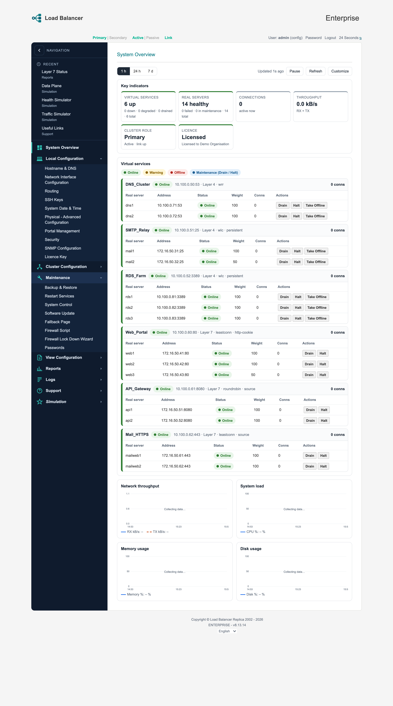
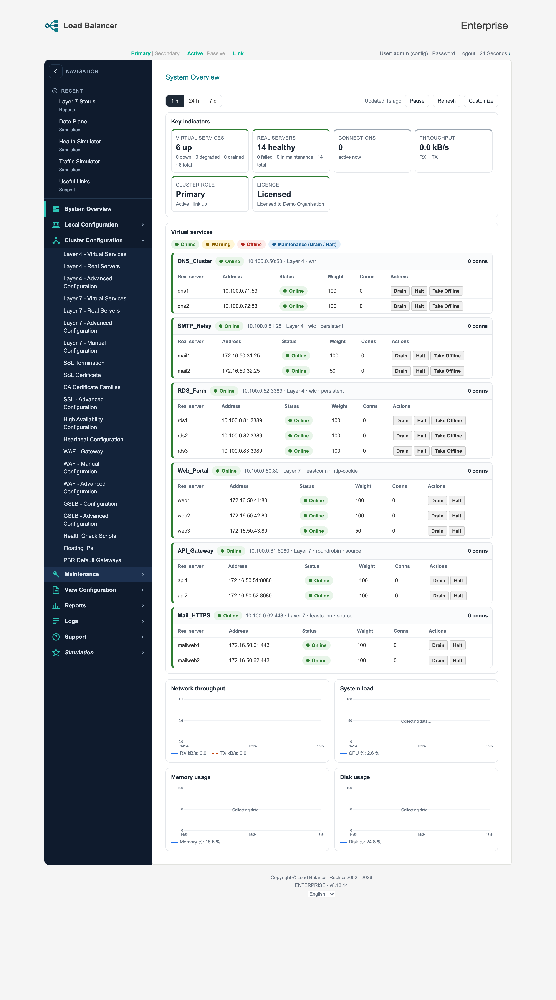
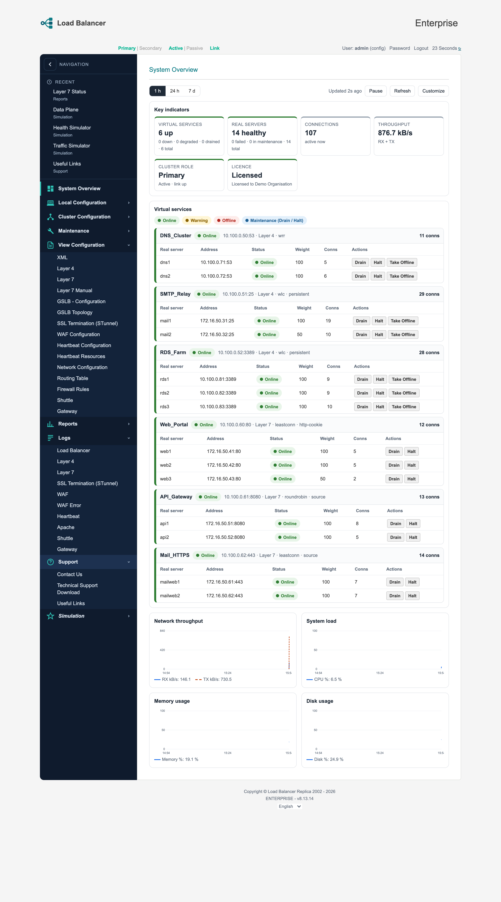
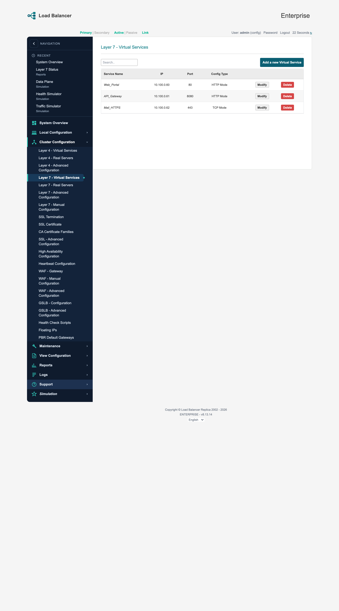
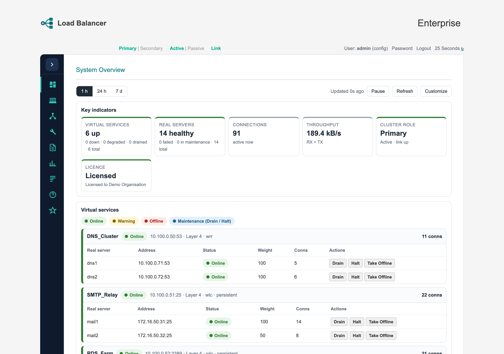
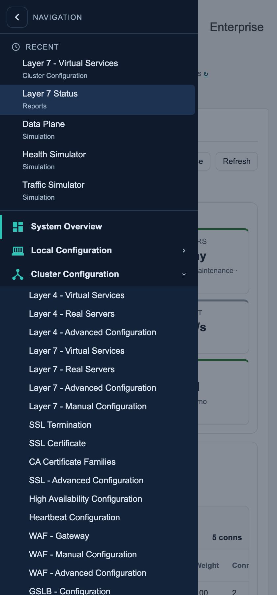

# Loadbalancer_xxi
## Screenshots

### Main menu and sidebar

| | |
|---|---|
|  |  |
| System Overview — Local Configuration and Maintenance menus | Cluster Configuration menu |
|  |  |
| View Configuration, Logs and Support menus | Layer 7 - Virtual Services |
|  |  |
| Compact icon-only sidebar | Mobile menu drawer |
