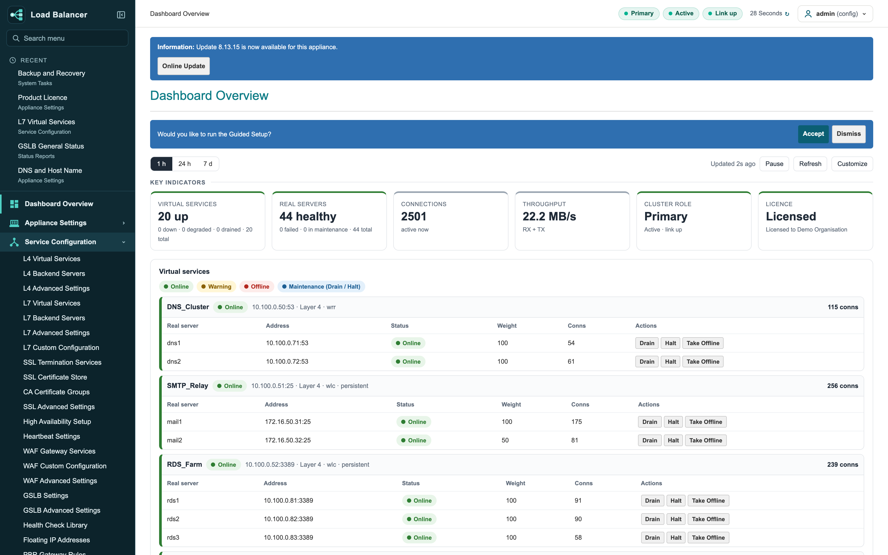
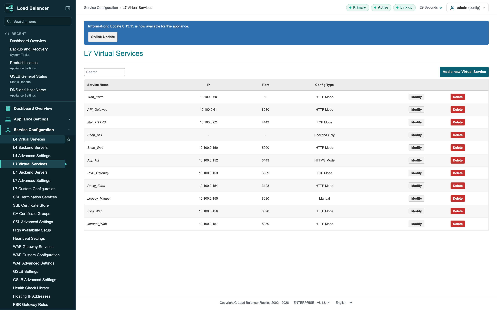
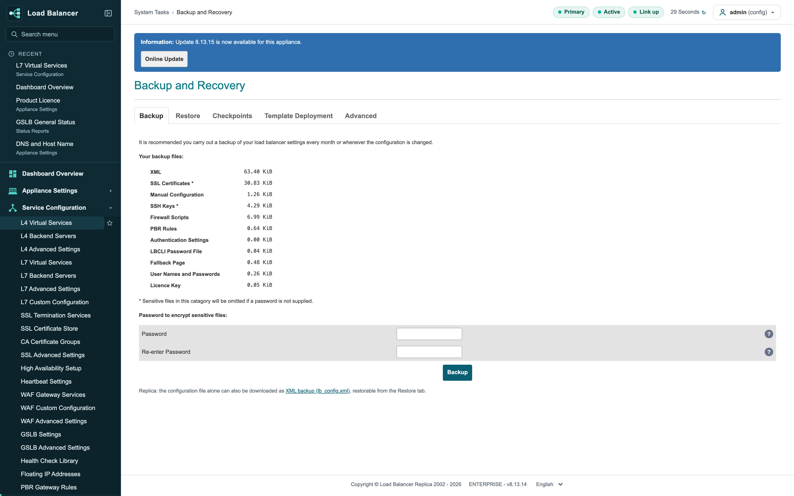
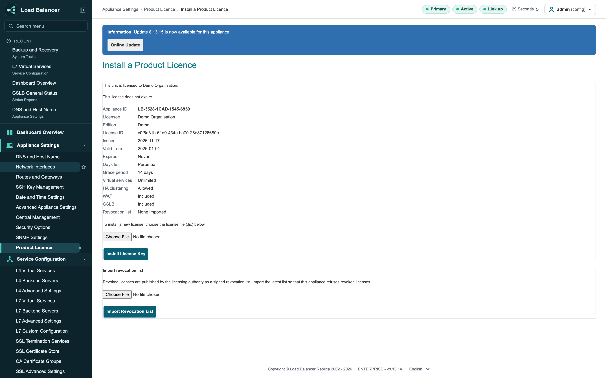
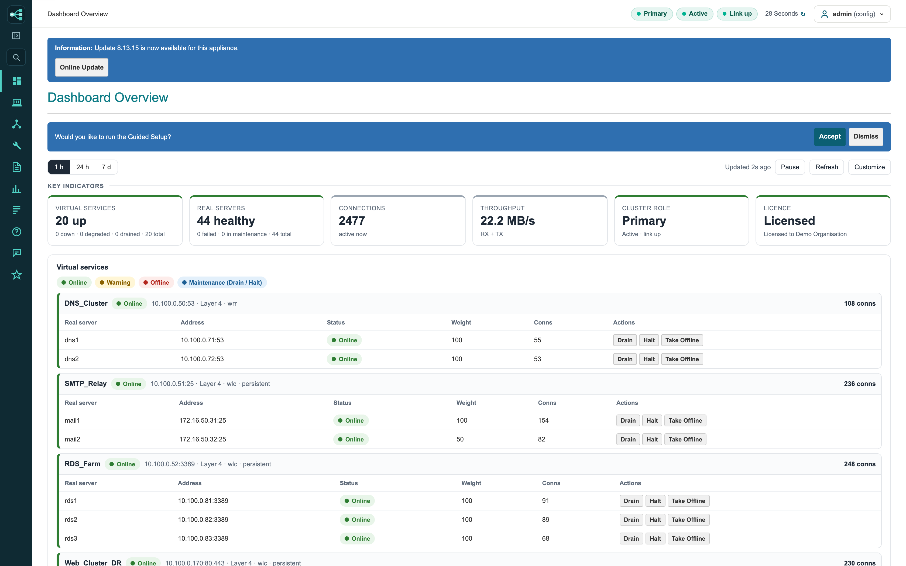
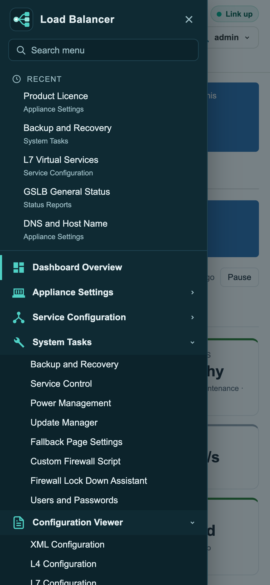
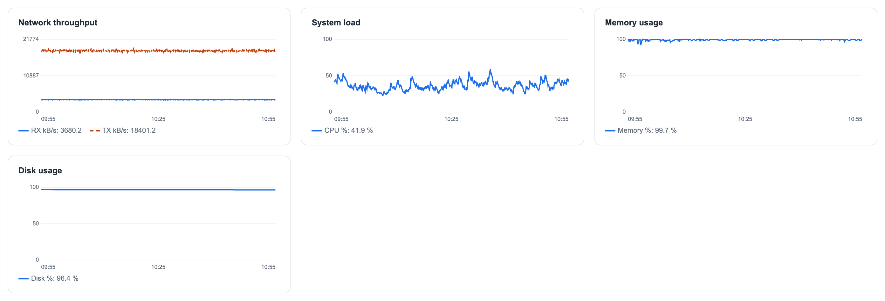

# Loadbalancer_xxi

Screenshots of the **Load Balancer** web console: full-page layout, main menu and sidebar, and the most important features.
All data shown is invented demo data with simulated live traffic.

## Dashboard

Key indicators, virtual services with their backend servers, live connections and throughput.

## Menus and features

| | |
|---|---|
|  |  |
| **Service Configuration** — L4/L7 services, SSL, HA, WAF, GSLB | **L7 Virtual Services** — HTTP/TCP services with persistence and health checks |
|  |  |
| **Backup and Recovery** — encrypted backups, restore, checkpoints | **Product Licence** — signed, time-based licences |
|  |  |
| **Compact icon-only sidebar** | **Mobile menu drawer** |

## Live traffic graphs

Dashboard Overview graphs over the last hour: network throughput (RX/TX kB/s) with live traffic, plus system load, memory and disk usage.

## Feedback

Comments and ideas are welcome in [Discussions](../../discussions); report problems in [Issues](../../issues).
